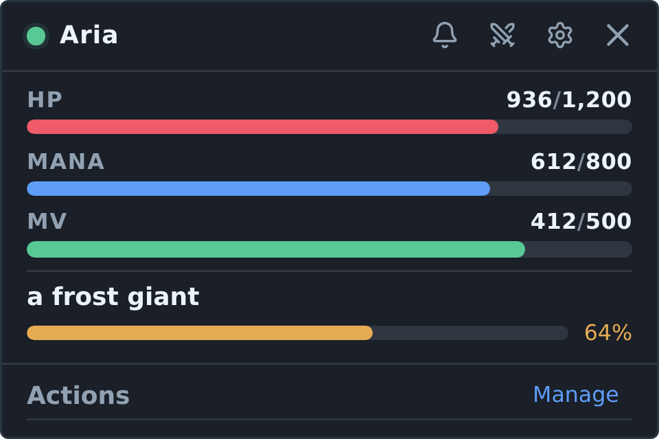

# Imp

**Interactive MUD Peripheral** is an alpha desktop HUD that runs alongside
Mudlet or TinyFugue, not instead of your MUD client. See your character's
vitals and target health, set alerts, and save commands to run on demand.
**AVATAR is the MUD whose GMCP mapping has been verified in live play.**

_Preview rendered in Chromium from the frontend shipped in the published
v0.5.3 Windows installer, using synthetic game data. This is not a capture of
the installed Windows app or live gameplay._

**[Download Imp for Windows x64](https://github.com/i-mud/imp/releases/latest)** — choose the `Imp_<version>_x64-setup.exe` installer under **Assets**. It's unsigned, so Windows may show a SmartScreen warning.

## Quick start

Use Imp only on computers where you trust the other users and programs. This applies to your Windows PC and any server running Imp.

### Local Mudlet on Windows

- **My MUD client runs on this computer.** Follow the [Mudlet on Windows quick start](docs/quickstart/mudlet-windows.md). You don't need a server.

### Remote TinyFugue on Linux

- **My MUD client runs on another computer or server.** Follow the [remote TinyFugue quick start](docs/quickstart/tinyfugue-remote.md).

#### What you need

The remote quick start lists the supported server and client prerequisites.

## First use

Imp is working when it shows your intended character and the vitals visibly
update as you play. A connection indicator or old values alone isn't enough.
See [installation checks and troubleshooting](docs/install-windows.md#verify-the-installation).
The [first-use guide](docs/first-use.md) explains the HUD and optional alerts and actions.

## Help, bugs, and alpha feedback

- **Setup help:** See [Windows verification and troubleshooting](docs/install-windows.md#verify-the-installation)
  or [server diagnostics](deploy/README.md#common-failure-diagnostics). If
  connected but not live, check the selected profile or world and its GMCP.
- **Bug or feature request:** Use the [issue chooser](https://github.com/i-mud/imp/issues/new/choose).
- **Tried the alpha?** Use the [alpha feedback form](https://github.com/i-mud/imp/issues/new?template=alpha_feedback.yml),
  even if setup worked. Tell us your route, which checkpoint you reached,
  where you got stuck, or what helped during play.

Never post passwords, keys, pairing tokens, raw GMCP, or raw game logs. Report
vulnerabilities privately via the [security policy](SECURITY.md).
See the [trust boundary](docs/architecture/boundaries/trust-boundary.md) for details.

## Development

Start with [development prerequisites and commands](CONTRIBUTING.md#development-setup),
then follow the [development guide](docs/development.md) to run Imp from source.

## Contributing

See the [contribution guide](CONTRIBUTING.md) for setup, testing, and pull
requests, and follow the [code of conduct](CODE_OF_CONDUCT.md).

[Architecture and repository map](docs/architecture/CONTEXT.md) ·
[Wire protocol](packages/protocol/SPEC.md) · [Status](docs/status.md) ·
[Roadmap](docs/roadmap.md) · [Audits](docs/audits.md) · [MIT license](LICENSE)
